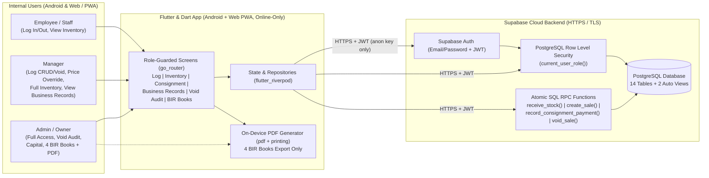
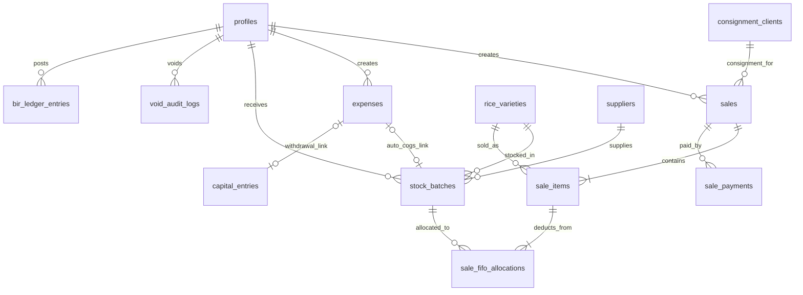

# EJBL System Architecture & Database Design (Flutter + Supabase)

**Status:** Planned technical design (not yet deployed or tested against a live Supabase project).  
**Stack:** Flutter & Dart (**Android & Web / PWA**, online-only; native iOS excluded) + Supabase (PostgreSQL, Auth, Row Level Security, SQL RPC Functions).

---

## 1. System Architecture Overview



---

## 2. Entity Relationship Diagram (Core Tables)



---

## 3. Flutter Project Structure (Layered, Feature-First)

```text
app/lib/
├── main.dart
├── app.dart
├── core/
│   ├── config/supabase_config.dart      # Env vars via --dart-define (never commit secrets)
│   ├── router/app_router.dart           # go_router with role-based route guards
│   ├── theme/app_theme.dart
│   └── utils/formatters.dart            # PHP currency, kg/sack helpers
├── features/
│   ├── auth/                            # Login, session provider, current_user_role
│   ├── log/                             # Log In (multi-item SI/NSI sales, split pay) & Log Out (expenses)
│   ├── inventory/                       # Stock summary, low-stock badge, FIFO batches, Receive Stock, Price Guide
│   ├── consignment/                     # B2B client accounts, unpaid/partial balances, record collection
│   ├── business_records/                # Auto Cashbook, Expenses, Daily Cash Box reconciliation (sobra/short)
│   ├── void_audit/                      # Immutable voided/cancelled log viewer for Owner/Admin
│   └── bir_books/                       # GL, CRJ, CDJ, GJ tabs + Capital + Owner manual edits + PDF export
```

---

## 4. Key Engineering Safeguards
1. **Server-Side RBAC (Never UI-Only):** Supabase RLS enforces `staff`, `manager`, and `admin` permissions at the database layer. Guide-price overrides are checked inside `create_sale()`.
2. **Atomic FIFO & Concurrency Safety:** `create_sale()` locks eligible `stock_batches` rows (`FOR UPDATE`) ordered by `received_date ASC, created_at ASC`, splits deductions across batches when needed, records exact `sale_fifo_allocations`, updates `sales`, inserts `sale_payments`, and posts to `bir_ledger_entries` inside one PostgreSQL transaction.
3. **Lossless Void / Cancel:** `void_sale()` never deletes rows—it marks the sale/payments `voided`, restores exact kilograms back to the exact original `stock_batches` via `sale_fifo_allocations`, appends a frozen JSONB snapshot to `void_audit_logs`, and posts reversing entries in `bir_ledger_entries`.
4. **Pending Bookkeeper Confirmation:** `bir_ledger_entries` uses a clean normalized ledger schema (`book_type`, `entry_date`, `reference_no`, `particulars`, `account_code`, `account_title`, `debit`, `credit`) so PDF column layouts can be adjusted in Flutter without rewriting the core transaction engine once the bookkeeper/accountant confirms exact BIR columns.
